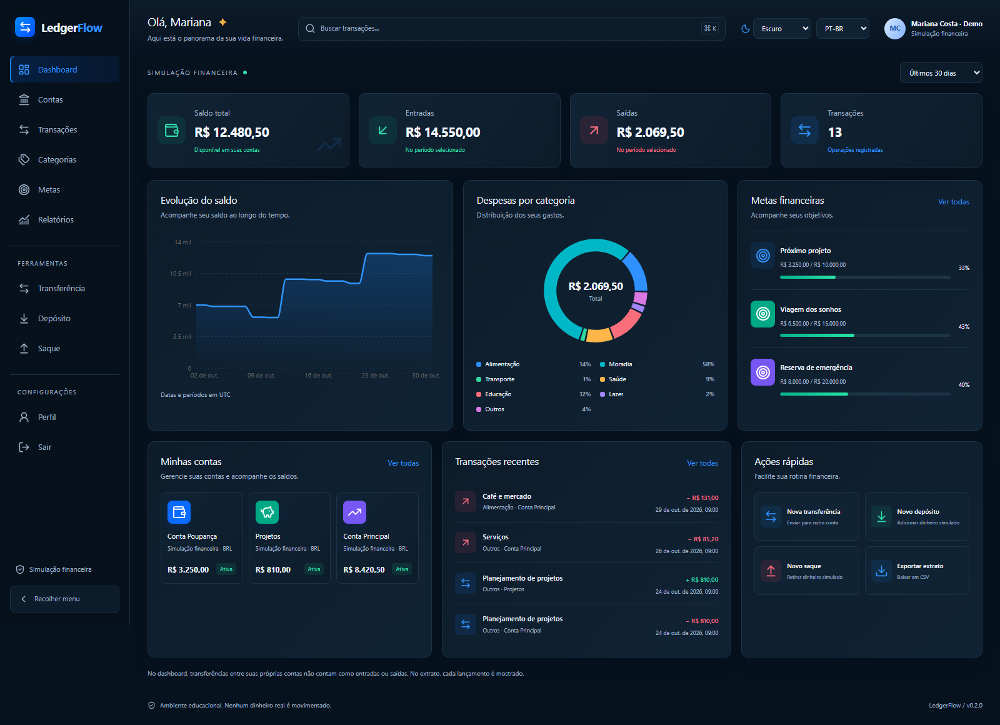
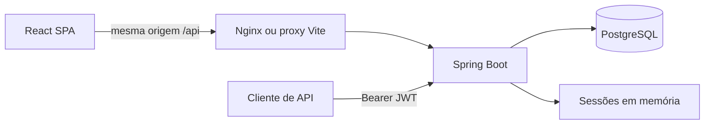
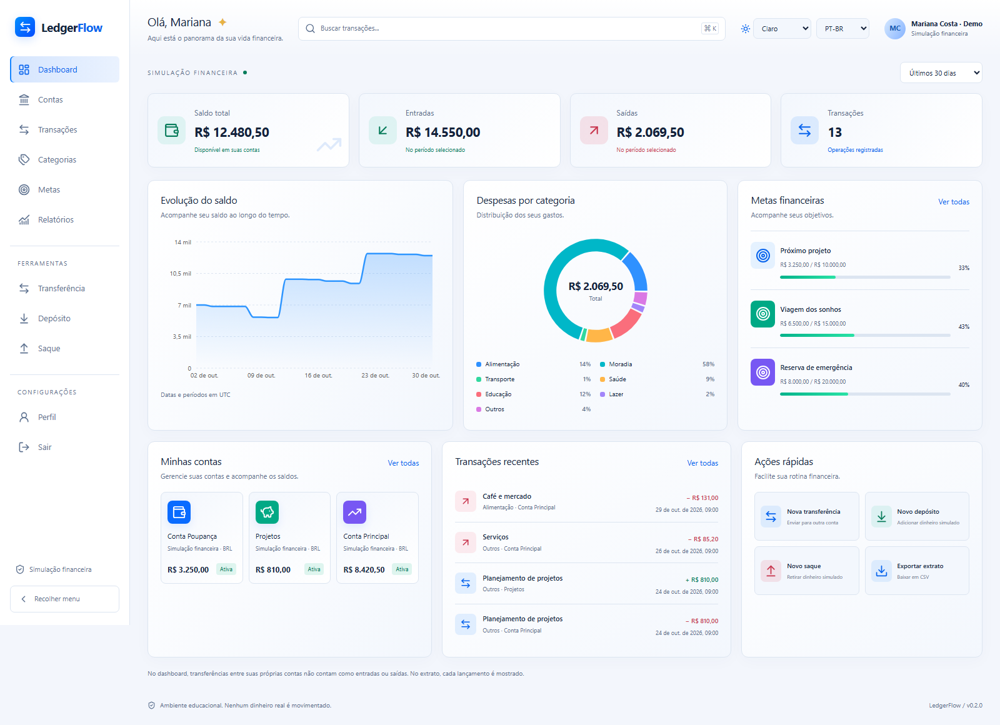
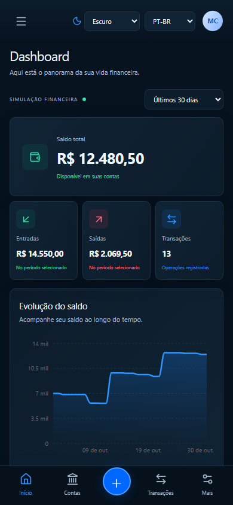

# LedgerFlow — Full Stack Financial Simulation

> 🇧🇷 **Documentação em Português (Brasil).**
>
> 🇺🇸 **The complete English version is available immediately after the Portuguese section.**

[Português](#-português-brasil) | [English](#-english)

**v0.2.0 — Full Stack.** Desenvolvimento em `DEV`; versões estáveis em `main`. / Development on `DEV`; stable versions on `main`. [Fluxo / Workflow](CONTRIBUTING.md) · [Releases](https://github.com/GuiNovaisz/ledgerflow-java-fintech/releases) · [CI](https://github.com/GuiNovaisz/ledgerflow-java-fintech/actions/workflows/ci.yml). A release v0.1.0 permanece preservada. / The v0.1.0 release remains unchanged.



## 🇧🇷 Português (Brasil)

### Visão geral e objetivo

LedgerFlow é uma aplicação educacional para gerenciar contas, movimentações e planejamento financeiro simulado. O objetivo técnico é demonstrar uma interface completa conectada a um backend que preserva saldo, propriedade dos dados e segurança de repetição de operações. Nenhum dinheiro real é movimentado e não há integração bancária.

### Funcionalidades

- Cadastro, login, perfil de leitura, expiração e logout de sessão no servidor.
- Dashboard com saldo total, entradas, saídas, quantidade de operações, evolução diária e despesas por categoria, calculados no PostgreSQL.
- Contas BRL: criação, detalhes, histórico e ativação/desativação.
- Depósitos, saques e transferências simulados, com confirmação, chave de idempotência e consulta do resultado após falha de rede.
- Extrato com busca textual, filtros, paginação e exportação CSV; relatório por período. A busca global abre o extrato filtrado.
- Categorias fixas traduzidas; metas com criação, edição, exclusão e controle de versão. Metas são planejamento manual e não reservam saldo.
- Temas escuro, claro e do sistema; PT-BR/EN; navegação adaptada a desktop e celular.

### Tecnologias e arquitetura

| Camada | Tecnologias utilizadas |
| --- | --- |
| Backend | Java 21, Spring Boot 3.5, Security, JPA, JDBC, Maven Wrapper |
| Dados | PostgreSQL 16, Flyway, `BigDecimal` / `NUMERIC(17,2)` |
| Frontend | React, TypeScript estrito, Vite, Tailwind CSS, primitivas próprias no padrão shadcn com Radix/CVA, Lucide |
| Estado e formulários | TanStack Query, React Hook Form, Zod, React Router, i18next |
| Gráficos e testes | Recharts, JUnit, Testcontainers, Vitest, Testing Library, Playwright |
| Execução | Docker Compose, Nginx sem root, GitHub Actions |



O backend é um monólito modular organizado por capacidade. Uma transferência altera saldos e grava lançamentos na mesma transação. Locks de linha em ordem estável coordenam escritores; um lock transacional por chave de idempotência coordena repetições. O frontend mantém valores monetários como texto decimal e centavos `BigInt`; números de ponto flutuante são usados somente para desenhar gráficos.

[Arquitetura Full Stack](docs/fullstack-architecture.md) · [Domínio e invariantes](docs/architecture.md) · [Design e comparação visual](docs/design-system.md)

### Segurança

O navegador usa cookie `HttpOnly`, `SameSite=Strict` e token CSRF em memória. Nenhum JWT ou cookie é salvo em localStorage: somente tema e idioma. APIs bearer permanecem em uma cadeia de segurança separada, sem herdar a sessão do navegador. Logout invalida a sessão; senhas usam BCrypt. Consultas e mutações validam o proprietário no servidor. CSV neutraliza fórmulas em texto controlado pelo usuário.

Sessões têm 15 minutos de inatividade e são perdidas ao reiniciar o backend. Para HTTPS, configure `SESSION_COOKIE_SECURE=true`. O limite de autenticação é básico e, no proxy local, compartilhado pelo endereço do Nginx; não é uma solução distribuída contra abuso. A [auditoria](docs/verification-v0.2.0.md) registra dois avisos condicionais do Spring MVC analisados como não aplicáveis às funcionalidades usadas; não se afirma ausência absoluta de vulnerabilidades.

### Interface real

As imagens vêm do Chromium sobre os serviços reais, com uma identidade fictícia criada pelo script de demonstração. Valores e curvas não são dados estáticos inseridos no componente.

| Claro | Mobile |
| --- | --- |
|  |  |

[Contas](docs/assets/screenshots/accounts.png) · [Transações](docs/assets/screenshots/transactions.png) · [Transferência](docs/assets/screenshots/transfer.png) · [Metas](docs/assets/screenshots/goals.png)

### Como executar — Docker

Requer Docker Engine com Compose. Node 24+ é necessário no host somente para o seed; Java 21 e Node são fornecidos pelas imagens durante o build.

No Windows com PowerShell 7, a opção isolada não sobrescreve o ambiente anterior:

```powershell
.\scripts\Start-FullStack.ps1 -Build -Demo
```

Frontend: [localhost:18081](http://localhost:18081). Swagger: [localhost:18080/swagger-ui.html](http://localhost:18080/swagger-ui.html). Credenciais fictícias aleatórias ficam no arquivo privado `.local/demo/latest.json`; não são publicadas. Nas próximas inicializações use o mesmo script sem `-Demo`, para reutilizar os dados. `-Demo` adiciona uma nova identidade; nunca limpa o banco.

Alternativa Compose padrão no PowerShell:

```powershell
.\scripts\New-LocalEnvironment.ps1  # apenas na primeira execução; recusa sobrescrita
docker compose up -d --build --wait
```

Essa alternativa usa frontend **8081**, API **8080**, PostgreSQL **5432**, sempre em loopback. Em Linux/macOS, gere `.env` sem substituir um arquivo existente:

```sh
(set -C; umask 077; printf 'POSTGRES_PASSWORD=%s\nJWT_SECRET=%s\n' "$(openssl rand -base64 36 | tr -d '\n')" "$(openssl rand -base64 48 | tr -d '\n')" > .env)
docker compose up -d --build --wait
```

Para parar preservando os dados, use `docker compose down` com o mesmo projeto/arquivo de ambiente da inicialização. Para o script isolado: `docker compose --env-file .local/fullstack.env -p ledgerflow-demo-v02 down`. Não use `-v` para preservar o volume.

### Desenvolvimento e testes

JDK 21 para Maven; Node 24+ para frontend; Docker para testes de integração. Para desenvolvimento do frontend, mantenha a API na porta 8080, execute `npm ci` e `npm run dev` em `frontend/`; o Vite serve **5173** e encaminha `/api` para **8080**. Para executar Java fora do Docker, configure `DB_URL`, `DB_USER`, `DB_PASSWORD`, `JWT_SECRET` no processo e rode `./mvnw spring-boot:run`. Não coloque segredos em comandos versionados.

```sh
./mvnw -B -Pintegration verify             # Windows: .\mvnw.cmd
cd frontend
npm ci
npm run lint
npm run typecheck
npm test
npm run build
npx playwright install chromium
# Com Compose padrão em 8081:
npx playwright test e2e/fullstack.spec.ts
```

Para as portas isoladas, defina `E2E_BASE_URL=http://127.0.0.1:18081` no processo. A captura opcional usa também `CAPTURE_PORTFOLIO=1` e `e2e/portfolio.spec.ts`, após criar a demo. Testes E2E criam somente identidades sintéticas novas. Não reutilizam o navegador pessoal.

Validação local: **51 testes Java**, **13 testes Vitest**, **6 cenários E2E** e **1 cenário de captura visual** aprovados. Lint, TypeScript e builds aprovados; npm audit sem achados. O workflow executa testes, builds, auditorias e E2E no GitHub; consulte o resultado do commit desejado em [Actions](https://github.com/GuiNovaisz/ledgerflow-java-fintech/actions/workflows/ci.yml). Evidências, limites e comandos: [verificação v0.2.0](docs/verification-v0.2.0.md).

### API e estrutura

| Capacidade | Rotas principais em `/api/v1` |
| --- | --- |
| Navegador | `/session/csrf`, `/session/register`, `/session/login`, `/session/me`, `/session/logout` |
| Clientes bearer | `/auth/register`, `/auth/login` |
| Contas | `/accounts`, `/accounts/{id}`, `/accounts/{id}/status` |
| Movimentações | `/transactions/deposits`, `/transactions/withdrawals`, `/transactions/transfers` |
| Dashboard e extrato | `/dashboard`, `/entries`, `/entries/export.csv` |
| Recuperação e metas | `/operations/by-key/{key}`, `/goals`, `/goals/{id}` |

OpenAPI detalha métodos e schemas. Operações exigem `Idempotency-Key`; repetir com a mesma chave e payload evita duplicidade. Os endpoints de relatórios por conta da v0.1.0 continuam disponíveis. [Exemplos bearer](docs/requests.http).

`src/`: backend e testes. `frontend/src/`: componentes, páginas, cliente HTTP, traduções e testes. `frontend/e2e/`: jornadas reais. `docker/`: frontend e proxy. `scripts/`: ambiente, demo e auditoria. `docs/learning/fullstack/`: [trilha de estudo e entrevistas](docs/learning/fullstack/README.md).

### Limitações e próximos passos

BRL somente; ledger interno, sem contabilidade geral completa, bancos, pagamentos ou conciliação externa. Categorias são fixas; metas têm progresso informado manualmente. Relatórios usam `[from,to)` em UTC, até 366 dias e CSV de até 10.000 linhas. Transferências próprias não contam como renda/despesa, mas geram dois lançamentos no extrato.

Sessões em memória, sem recuperação de senha, MFA ou verificação de e-mail. JWTs de clientes externos expiram em 15 minutos, sem revogação imediata. Uma operação incerta mantém a chave na aba; fechar/recarregar a aba perde esse contexto, exigindo consulta ao extrato antes de uma nova tentativa. Não há garantia de conformidade WCAG completa; E2E cobre Chromium, sem uma matriz completa de navegadores. Não há implantação pública.

Próximas melhorias: identidade e sessões distribuídas; conciliação automática entre saldos e lançamentos com observabilidade; acessibilidade e cobertura em múltiplos navegadores. [MIT](LICENSE) · [Changelog](CHANGELOG.md) · [Notas da v0.2.0](docs/releases/v0.2.0.md).

---

## 🇺🇸 English

### Overview and purpose

LedgerFlow is an educational application for simulated accounts, transactions and financial planning. It demonstrates a complete user interface backed by explicit ownership, balance consistency and safe retry rules. It does not move real funds or connect to banks.

### Features

- Registration, login, read-only profile, server-side session expiry and logout.
- Database-backed dashboard: total balance, income, expenses, operation count, daily balances and category breakdown.
- BRL account creation, details, history and activation/deactivation.
- Simulated deposits, withdrawals and transfers with confirmation, idempotency and outcome lookup after network failure.
- Searchable, filtered, paginated statements, period reports and CSV export. Global search opens a filtered statement.
- Translated fixed categories and versioned planning-goal CRUD. Goal progress is manual; it does not reserve funds.
- Dark, light and system themes; Portuguese/English; desktop and mobile navigation.

### Tech stack and architecture

Java 21, Spring Boot 3.5, Security, JPA/JDBC, PostgreSQL 16, Flyway and Maven Wrapper form a modular monolith. The frontend uses React, strict TypeScript, Vite, Tailwind, owned shadcn-style Radix/CVA primitives, Lucide, TanStack Query, React Hook Form, Zod, React Router, i18next and Recharts. Tests use JUnit, Testcontainers, Vitest, Testing Library and Playwright. Docker Compose runs PostgreSQL, Java and an unprivileged Nginx frontend; GitHub Actions verifies changes.

The diagram above shows the same-origin browser/proxy/API flow and the separate bearer-client flow. A transfer changes balances and writes postings in one database transaction. Ordered row locks coordinate writers; transaction-scoped advisory locks coordinate idempotency keys. Money uses `BigDecimal` / `NUMERIC(17,2)` on the server and decimal strings / `BigInt` cents on the client. Floating-point values are used only for chart rendering. [Full architecture](docs/fullstack-architecture.md) · [Domain invariants](docs/architecture.md).

### Security

The browser uses an HttpOnly, SameSite=Strict session cookie and an in-memory CSRF token. Only theme/language preferences enter localStorage. Bearer clients use a separate stateless security chain that does not inherit cookie authentication. Logout invalidates the server session; passwords use BCrypt; server-side ownership checks protect data. CSV output neutralizes spreadsheet formulas in user-controlled text.

Sessions expire after 15 idle minutes and disappear on backend restart. Set `SESSION_COOKIE_SECURE=true` for HTTPS. Authentication throttling is basic; the local Nginx proxy shares an IP-based allowance and is not a distributed abuse-control solution. Two conditional Spring MVC advisories remain explicitly assessed as not applicable to the used features. See the [verification report](docs/verification-v0.2.0.md); this is not a claim of complete security.

### UI

All screenshots above were captured from Chromium against real services with synthetic persisted demo data. Charts are driven by the API. [Accounts](docs/assets/screenshots/accounts.png), [transactions](docs/assets/screenshots/transactions.png), [transfer](docs/assets/screenshots/transfer.png), [goals](docs/assets/screenshots/goals.png), [visual comparison](docs/design-system.md).

### Running locally and Docker

Docker Engine with Compose is required. Host Node 24+ is needed for the demo seed only; image builds supply Java and Node. On Windows PowerShell 7, run `./scripts/Start-FullStack.ps1 -Build -Demo`. It creates an isolated project at frontend **18081**, API **18080**, database **15432**, preserving older data. Random demo credentials stay in private `.local/demo/latest.json`. Restart without `-Demo` to reuse them; the seed adds new synthetic identities and never resets a database.

For standard Compose, run `./scripts/New-LocalEnvironment.ps1` once, then `docker compose up -d --build --wait`. The script refuses to overwrite `.env`. On Linux/macOS, use the protected `openssl` environment-generation command shown in the Portuguese section. Standard ports are **8081 / 8080 / 5432**, bound to loopback. Stop with `docker compose down`, supplying the same project and environment options; omit `-v` to retain data.

For development, use host JDK 21 and Node 24+. With the API on 8080, run `npm ci` and `npm run dev` in `frontend/`; Vite listens on **5173** and proxies `/api`. To run Java outside Docker, provide `DB_URL`, `DB_USER`, `DB_PASSWORD`, `JWT_SECRET` as process environment variables and run `./mvnw spring-boot:run` (`.\mvnw.cmd` on Windows).

### Testing

Run `./mvnw -B -Pintegration verify` with Docker available. In `frontend/`, run `npm ci`, `npm run lint`, `npm run typecheck`, `npm test`, `npm run build`, `npx playwright install chromium`, and `npx playwright test e2e/fullstack.spec.ts` against running Compose. Set `E2E_BASE_URL` when using nonstandard ports. Optional portfolio capture uses `CAPTURE_PORTFOLIO=1`, the seeded demo and `e2e/portfolio.spec.ts`. Tests use isolated contexts and new synthetic identities.

Local verification: **51 Java tests**, **13 Vitest tests**, **6 E2E scenarios**, and **1 visual-capture scenario** passed. Lint, types and builds passed; npm audit found no advisories. GitHub Actions runs tests, builds, audits and E2E; inspect the required commit in [Actions](https://github.com/GuiNovaisz/ledgerflow-java-fintech/actions/workflows/ci.yml). [Evidence and scope](docs/verification-v0.2.0.md).

### API and project structure

Swagger is available at `/swagger-ui.html` on the API port. The route table above lists browser sessions, legacy bearer authentication, accounts, operations, owner-wide analytics, statements, outcome lookup and goals. Financial mutations require `Idempotency-Key`; retries must keep both key and payload unchanged. Existing per-account report endpoints remain supported. [Bearer examples](docs/requests.http).

`src/` contains Java and its tests; `frontend/src/` contains UI, HTTP client, translations and tests; `frontend/e2e/` holds browser journeys; `docker/` defines the frontend/proxy; `scripts/` provides setup, fixtures and audits; [learning materials](docs/learning/fullstack/README.md) explain the implementation and interview topics.

### Known limitations, roadmap and disclaimer

BRL only; an internal account ledger rather than a full general ledger. No banks, payment rails or external reconciliation. Categories are fixed; goals are manual planning records. Reports use UTC half-open intervals, at most 366 days and 10,000 CSV rows. Own-account transfers are excluded from cash flow but produce two statement postings.

Sessions are in memory. There is no password recovery, MFA or email verification. External-client JWTs expire after 15 minutes without immediate revocation. Uncertain-operation recovery state lives in the current tab; closing/reloading loses that context, so inspect history before initiating another operation. Full WCAG conformance and cross-browser coverage are not claimed; E2E uses Chromium. No public deployment is provided.

Next priorities: stronger identity/distributed sessions, automated reconciliation and operational visibility, and broader accessibility/browser coverage. **Educational financial simulation only; no real money moves.** [MIT License](LICENSE) · [Changelog](CHANGELOG.md) · [v0.2.0 release notes](docs/releases/v0.2.0.md).
