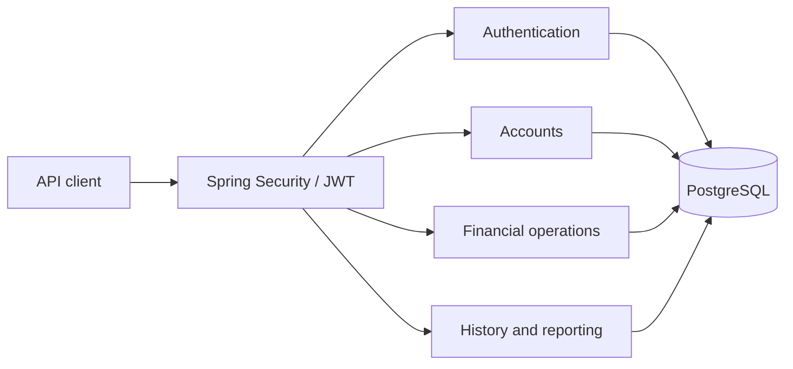

# LedgerFlow architecture

> This document explains the original ledger/backend design. For v0.2.0 browser sessions, analytics, planning goals and frontend boundaries, see [Full Stack architecture](fullstack-architecture.md). The bearer-only description below describes the preserved API-client flow, not the new browser flow.

LedgerFlow is a financial simulation built as one Java 21 / Spring Boot application with Maven and PostgreSQL. Deposits and withdrawals represent simulated money entering or leaving the system. It has no banking, card, payment-provider, settlement, or real-money integration.

## Modules and boundaries

The application is a modular monolith: one deployable process and one transactional database, organized by business capability under `com.ledgerflow`.

| Module | Responsibility |
| --- | --- |
| `auth` | Registration, BCrypt password verification, JWT issuance, authenticated user identity |
| `account` | Owner-scoped account creation, reads, and active/inactive lifecycle |
| `ledger` | Deposits, withdrawals, transfers, idempotency, balances, immutable financial records |
| `reporting` | Paginated history, date-range summaries, category totals, CSV export |
| `shared` | Error responses, common validation, and narrowly scoped infrastructure |

HTTP controllers validate transport input and delegate business decisions to services. Repository access stays behind the relevant service boundary. Reporting reads committed financial data and never changes balances. The financial service owns the transaction that changes all affected accounts and records the operation.

## Authentication and isolation

Passwords are stored only as BCrypt hashes. Login returns a signed, expiring JWT whose subject identifies the user. Spring Security's OAuth2 Resource Server support validates bearer tokens using Nimbus; application code does not implement a separate authentication filter. Signing material belongs in environment configuration, never in source control. Tokens have a bounded lifetime; this initial design does not provide refresh tokens or immediate token revocation.

Protected requests derive the initiating user exclusively from the verified token. A request body cannot choose its owner. Account reads and lifecycle changes, deposits, withdrawals, and transfer debits require ownership. A foreign identifier on those owner-only paths produces the same not-found behavior as a nonexistent identifier.

Transfers can credit any existing active account, including another user's account. Recipient lookup is internal: a successful transfer response may identify the recipient account UUID already supplied by the caller, but must not reveal its owner's name, email, other accounts, or resulting balance. History and reports scope postings through the authenticated user's account ownership, so a recipient can see an incoming transfer initiated by another user. The operation's initiator is not sufficient as the history ownership predicate.

## Money and account lifecycle

Amounts use `BigDecimal` in Java and fixed-scale `NUMERIC` in PostgreSQL. Inputs must be positive, fit the supported precision, and have at most two fractional digits; normalization to two decimal places must never silently round a submitted value. No calculation uses floating point. Transfers require matching currencies.

New accounts begin with a zero balance. An inactive account remains visible in history and reports, but cannot receive new deposits, withdrawals, or transfers. Reactivation preserves its balance and history. Account status changes take the same account row lock as financial operations, so status validation and posting cannot race.

## Financial transaction protocol

PostgreSQL `READ COMMITTED` plus explicit locking is the chosen concurrency model. Each financial request follows this sequence inside one database transaction:

1. Validate transport-independent input and derive the authenticated owner.
2. Acquire a transaction-scoped advisory lock derived from owner and idempotency key.
3. Look up an existing successful request for that exact owner and key. Return its saved operation when the canonical fingerprint matches; otherwise reject key reuse with a conflict.
4. Lock all involved account rows in a consistent UUID order, using `SELECT ... FOR UPDATE` (or its repository equivalent). Check source ownership, distinct transfer endpoints, activity of both accounts, matching currency, and sufficient funds while holding the locks. Deposits and withdrawals also require ownership of their affected account.
5. Update balances, insert the operation and immutable account postings, and save the idempotency result.
6. Commit once. Any exception rolls back every balance update, financial record, and idempotency insert.

Replay lookup precedes account lifecycle validation: a retry of a committed deposit still returns that original result if the account has since become inactive. Failed requests do not reserve a successful result; they can be retried after their underlying condition changes.

The advisory lock is transaction scoped, so PostgreSQL releases it on commit or rollback. Its hash is a contention mechanism, not an identity check: the exact owner/key and fingerprint are always compared in persisted data. A hash collision can delay unrelated requests but cannot replay another request. A unique database constraint on owner plus key remains the final duplicate guard. All code paths acquire the advisory lock before account locks and acquire multiple account locks in the same order, reducing deadlock risk.

For a withdrawal or transfer, the sufficient-funds check runs after the source row is locked. Two simultaneous debits therefore cannot both spend the same starting balance. Locking both transfer endpoints also prevents lost credits. No network call belongs inside this financial transaction.

## Record and schema invariants

An operation identifies one completed business request. An account posting records a positive amount and a debit or credit direction; it does not store the resulting balance. A transfer creates one operation and two postings; a deposit or withdrawal creates one operation and one posting. Operation timestamps are normalized to PostgreSQL's microsecond precision, keeping initial responses and later replays consistent. This is an immutable account ledger for a simulation, not a complete general-ledger accounting system with external clearing accounts.

| Invariant | Enforcement |
| --- | --- |
| Users have unique normalized email addresses | Database unique constraint plus request validation |
| Account balances never become negative | Locked service validation and database `CHECK (balance >= 0)` |
| Monetary values fit two fractional digits and supported precision | Input validation and fixed-scale numeric columns |
| Operation amounts are positive | Service validation and database check |
| Foreign identifiers cannot expose another user's data | Owner-scoped reads and source mutations; restricted recipient lookup and response |
| A successful owner/key pair has only one result | Database unique constraint and transaction advisory lock |
| Reused keys with a changed operation are rejected | Persisted canonical request fingerprint |
| An operation has exactly its expected postings, with matching accounts, directions, amounts, and timestamps | Deferred database constraint triggers plus one service transaction |
| Completed operations and postings cannot be edited or deleted | Database triggers rejecting `UPDATE` and `DELETE` |
| Financial relationships remain valid | Foreign keys; financial records are not cascade-deleted |

The canonical fingerprint includes operation type, source/target account identifiers, normalized amount, and all other request fields that affect the stored result, such as category and description. It excludes transport details and the idempotency key itself. Different JSON field order or equivalent monetary formatting must not change the fingerprint.

Database checks protect individual rows, while deferred constraint triggers verify an operation's postings at commit. Source account ownership and agreement between cached balances and postings are service-level invariants, verified by integration tests. The immutable ledger provides a reconciliation trail. Corrections, if introduced later, must create compensating operations rather than mutate history.

## History, summaries, and CSV

History uses bounded pagination and a stable descending order by timestamp plus unique identifier. Date filters have explicit UTC semantics: an inclusive lower bound and exclusive upper bound, `[from, to)`. Empty ranges produce an empty page and zero summary totals. Invalid or reversed ranges are rejected. Categories describe operations and support grouped reporting.

Reports use committed postings belonging to the selected owner-scoped account. Only BRL is supported. Summary `income` is the sum of all credits, `expenses` is the sum of all debits, and `net` is their difference. These are account cash-flow totals: incoming and outgoing transfers are included. Expense category totals group debits, including transfer debits, by their recorded category. Transfer history shows the debit on the sender's account and the credit on the recipient's account; the caller can only see sides belonging to their own accounts.

CSV export applies the same account ownership and date filters as history and includes each posting's category. It uses a fixed documented column order, UTF-8, proper CSV escaping, and protection against spreadsheet formulas in user-controlled text. Export size is bounded to 10,000 entries to keep memory use predictable. Each reporting request uses a repeatable-read transaction for a consistent snapshot. Separately requested history pages can differ if new operations commit between requests.

## Failure behavior and verification

Client errors use consistent structured responses: invalid input is a bad request, missing/invalid authentication is unauthorized, an unavailable owner-scoped resource is not found, and conflicting lifecycle, balance, or idempotency state is a conflict. Domain services use the shared `BusinessException(HttpStatus status, String code, String message)` contract. Internal errors must not expose SQL, password hashes, tokens, signing material, or stack traces.

Unit tests exercise monetary validation, account rules, authentication, JWT validation, and CSV escaping. PostgreSQL Testcontainers integration tests verify idempotency fingerprints and behavior against the production database engine, including:

- Atomic rollback when a transfer fails after work has begun.
- Concurrent withdrawals competing for funds, with a nonnegative final balance and exactly the committed postings.
- Concurrent retries with one idempotency key, producing one operation and the same result for both callers.
- Opposite-direction transfers with consistent lock order and conserved combined balance.
- Idempotency conflicts, source ownership, cross-user recipient privacy, incoming-transfer visibility, inactive-account rejection, and immutable-record protection.
- Date boundaries, deterministic pagination, category totals, and CSV escaping.

Concurrency tests synchronize independent transactions rather than assume that sequential requests establish concurrency correctness. Testcontainers requires a working Docker-compatible engine; a skipped or unexecuted integration suite must be reported explicitly. Build success alone does not establish transaction correctness.

## Operational limits

Flyway migrations version the PostgreSQL schema. Runtime schema auto-generation is disabled. Database credentials, JWT signing secrets, and deployment configuration come from environment variables. The initial deployment is one application instance with a bounded connection pool; database locks keep transaction correctness when additional instances are introduced.

The simulation deliberately excludes overdraft, fees, interest, currency conversion, scheduled payments, reconciliation with external institutions, KYC/AML workflows, and production financial compliance. These require separate product and architecture decisions rather than implicit behavior in the current services.

## References

- [PostgreSQL 16 explicit locking](https://www.postgresql.org/docs/16/explicit-locking.html): row locks, deadlocks, and transaction-scoped advisory locks.
- [Spring Security JWT resource server](https://docs.spring.io/spring-security/reference/servlet/oauth2/resource-server/jwt.html): bearer JWT validation with Nimbus.
- [Spring Boot 3.5 requirements](https://docs.spring.io/spring-boot/3.5/system-requirements.html): Java compatibility and build requirements.
- [Springdoc v2](https://springdoc.org/v2/): Spring Boot 3 integration and compatibility.
