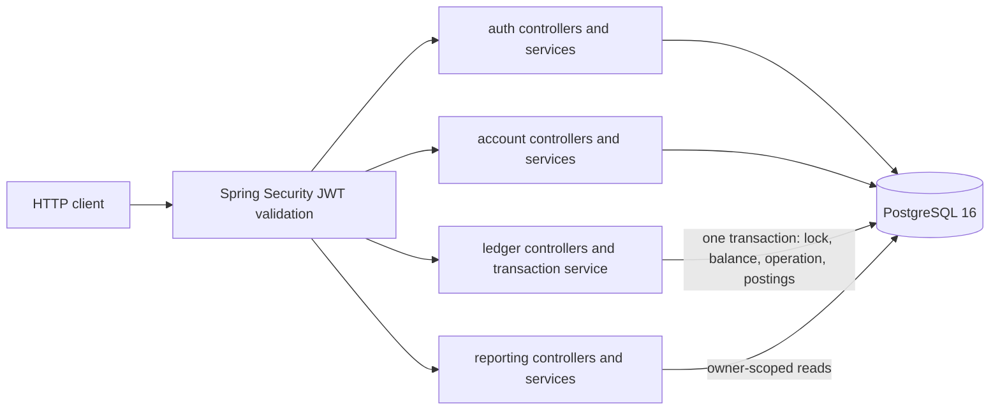
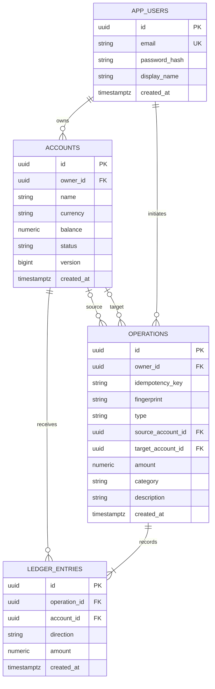

# LedgerFlow diagrams

These diagrams describe the current implementation. See [architecture.md](architecture.md) for invariants, security boundaries, and transaction behavior.

## Request and persistence shape

## Entity relationship diagram

`source_account_id` and `target_account_id` are nullable because deposit and withdrawal have only one endpoint. The pair `(owner_id, idempotency_key)` has a composite unique constraint. A transfer has both endpoints and produces one `DEBIT` and one `CREDIT` posting. Operations and postings are append-only; the account balance is a locked, cached current balance.
