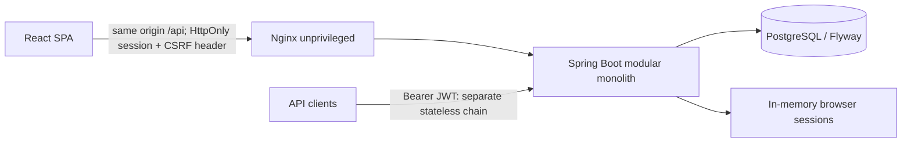

# Full stack architecture / v0.2.0

## Scope and preservation

The v0.1.0 annotated tag and release point to `1e631f5dc95e6800a6902cd07b48967391c2b123`. They are immutable historical milestones. Work for v0.2.0 is isolated on `feature/fullstack-dashboard`; no public deployment, merge, tag or release occurs before explicit final approval.

The existing Java project stays at the repository root. `frontend/` contains the SPA; `docker/` contains its image/proxy configuration. There is one business backend: Spring Boot. Node is build/development tooling only.

## Mapping the references to real functionality

| Visual element | Classification | Implementation decision |
| --- | --- | --- |
| Accounts, deposit, withdrawal, transfer | Existing; needs integration | Preserve transaction/row-lock/advisory-lock invariants and real API responses |
| Dashboard totals and charts | Needs extension | Owner-scoped SQL aggregates and daily balance reconstruction from persisted postings |
| Categories | Existing enum; needs integration | Translate labels; never translate stored enum identifiers; no fictitious custom-category CRUD |
| Transaction search/filter/pagination | Needs extension | Server-side filters over all owner entries, not only the loaded page |
| Financial goals | Justified new feature | Full CRUD, migration, owner isolation and version conflict protection; manually tracked planning, no fund reservation |
| Theme/language/profile | Integration and UI preferences | Real user identity; only theme/language in browser storage |
| Transfer wizard | Needs integration | Input, confirmation, processing, result; retain original request and idempotency key through uncertain outcomes |
| Percentage growth in mockup | Optional, not a requirement | Do not invent period comparisons; display supported metrics only |
| Cards, AI assistant, notifications, bank brands | Decorative or outside domain | Omit; no fake issuer, AI service or notification counter |
| Password recovery/MFA | Outside implemented scope | No fake email delivery or security switches |

## Authentication and origin boundaries

The browser uses a server-side session via an HttpOnly cookie and CSRF tokens fetched into memory. Bearer JWT support remains available for existing API clients, in a separate stateless chain that does not reuse browser authentication. Session expiry and logout are enforced by the server. A forged Authorization header cannot turn cookie authentication into a CSRF-exempt request.

Vite proxies `/api` in development; Nginx proxies `/api` in Compose. Neither arrangement needs wildcard CORS. Production HTTPS must set `SESSION_COOKIE_SECURE=true`. The local demo deliberately uses loopback HTTP. In-memory sessions are invalidated on backend restart and are not a distributed-session solution.

## Financial semantics

Money remains `BigDecimal` / PostgreSQL `NUMERIC(17,2)`. Existing REST contracts remain supported. New analytics DTOs use decimal strings; the frontend preserves decimal text for amounts and submits decimal strings. Chart coordinates may use floating-point for drawing only, never for committing money.

Owner-wide cash flow excludes transfers between that owner's own accounts. A transfer to another owner is an outflow and a received transfer an inflow. The transaction metric counts distinct operations visible to the owner, while the statement lists account postings, so a same-owner transfer can have two rows. Total balance includes active and inactive owned accounts. Date filters are UTC half-open intervals with PostgreSQL microsecond precision; report requests are bounded to avoid unbounded daily series.

Goals are planning records. Their manually entered current value neither moves nor reserves ledger funds. Optimistic version checks prevent silent overwrite when multiple tabs edit a goal.

## Delivery and limits

The new baseline was rerun on 2026-10-29: 38 tests passed, zero skipped. Subsequent results are recorded separately in the v0.2.0 verification report after implementation. Source review does not imply production certification, complete WCAG conformance, or real-bank readiness.

Relevant references: [Spring CSRF](https://docs.spring.io/spring-security/reference/6.5/servlet/exploits/csrf.html), [Nginx unprivileged image](https://github.com/nginx/docker-nginx-unprivileged), [WCAG 2.2](https://www.w3.org/TR/WCAG22/).
